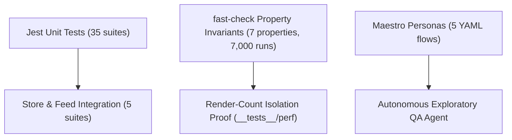

# Testing and QA Guide: Live Portfolio

This document details the test architecture, execution commands, and automation harnesses for the Live Portfolio application.

---

## 1. Test Architecture Overview



---

## 2. Running Automated Tests

### Unit and Integration Tests
```bash
# Run all 42 test suites with Jest
npm test

# Run fast-check property tests only (1,000 runs per invariant)
npx jest __tests__/domain/propertyInvariants.test.ts

# Run performance render-isolation tests only
npx jest __tests__/perf/isolatedRowRerender.test.tsx
```

### Static Analysis
```bash
# Verify strict TypeScript (0 errors)
npm run typecheck

# Verify ESLint code standards (0 errors, 0 warnings)
npm run lint
```

---

## 3. Testability and Simulator Controls

### Environment Variables & Modes
- `EXPO_PUBLIC_API_MODE`: Configures the OHLC API client behaviour without code modifications.
  - `live`: Hits `https://api.v2.liquide.life/api/markets/ohlc` (default).
  - `mock`: Serves `fixtures/ohlc.json` offline without network traffic.
  - `slow`: Injects 2000 ms artificial latency to test loading spinners.
  - `fail`: Simulates HTTP 500 error to test error views and retry buttons.
  - `partial`: Omits certain symbols to test partial responses.
  - `empty`: Serves empty quotes dictionary.
  - `malformed`: Returns invalid payload to test parse error handling.
- `QA_SEED`: Sets a deterministic 32-bit PRNG seed (`Mulberry32`) for the market feed. Two runs with identical `QA_SEED` produce identical tick sequences.

### Typed TestID Conventions
All interactive and value elements follow the typed convention:
`screen.element[.symbol]`
Exported via `src/testing/ids.ts`.

---

## 4. End-to-End Persona Testing (Maestro)

Install Maestro:
```bash
curl -FsSL "https://get.maestro.mobile.dev" | bash
```

Run E2E persona flows against an active emulator or device:
```bash
# Newbie user (Happy path: opens app, reads summary, buys 10 shares)
maestro test e2e/flows/newbie.yaml

# Active trader (Sorts by value, filters TCS, sells share, adds to watchlist)
maestro test e2e/flows/trader.yaml

# Chaos user (Zero, negative, float quantities, rapid theme toggles)
maestro test e2e/flows/chaos.yaml

# Stale feed user (Forces simulated disconnect, verifies paused banner)
maestro test e2e/flows/stale_feed.yaml
```

---

## 5. Traceability Matrix
See [`docs/test-cases/TRACEABILITY.md`](./test-cases/TRACEABILITY.md) for the complete mapping of every specification clause to automated test suites.
